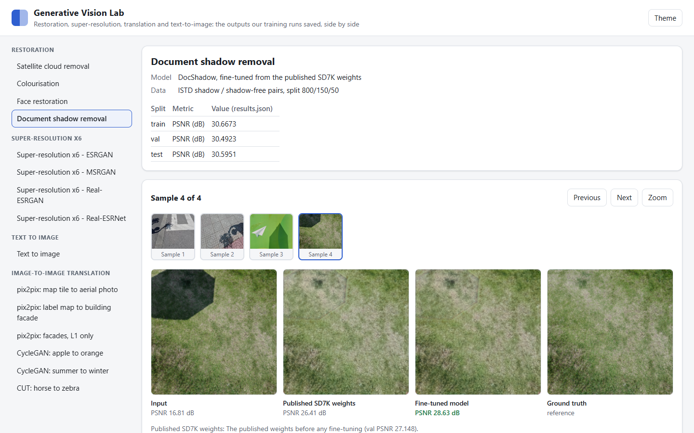
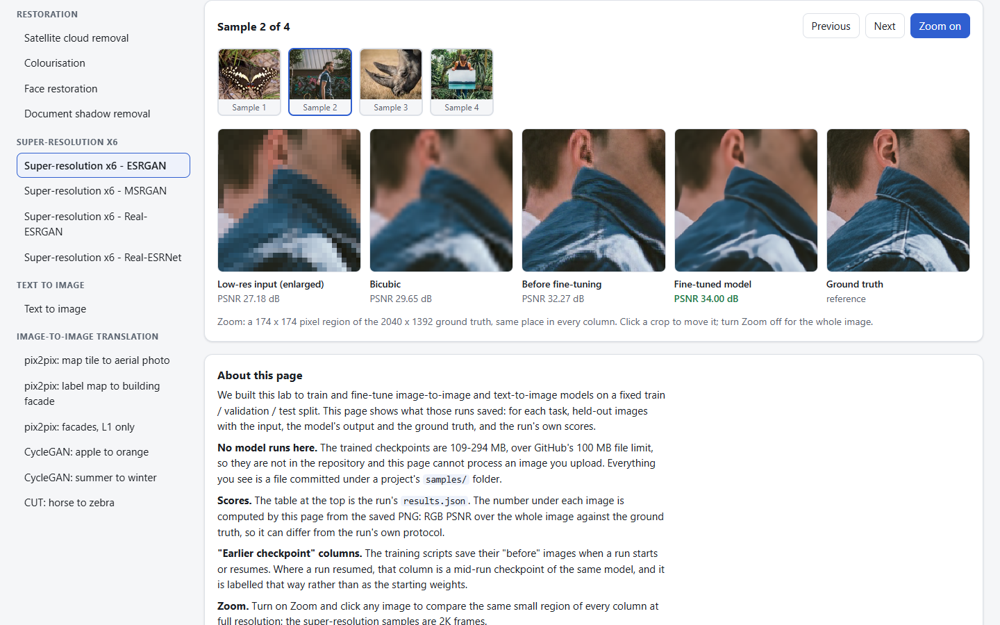
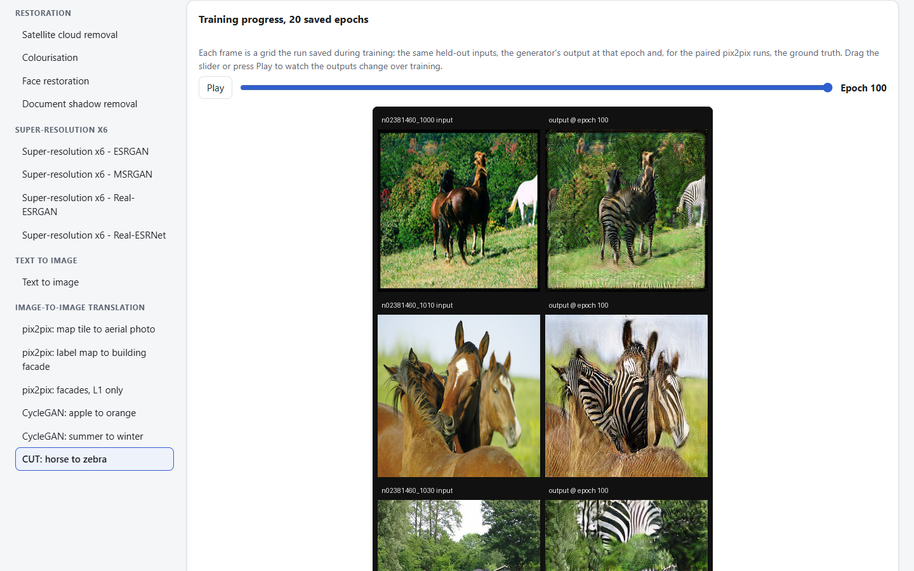
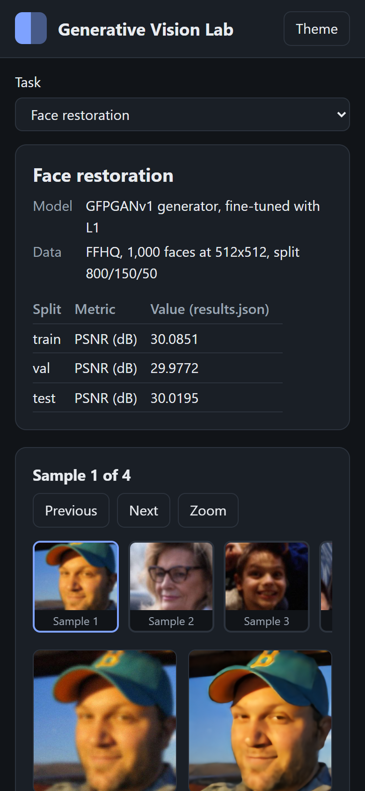
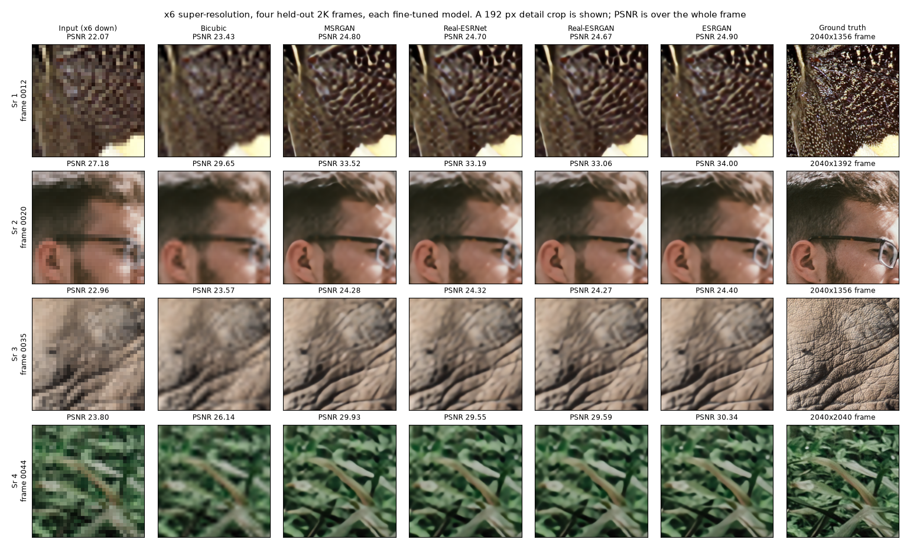
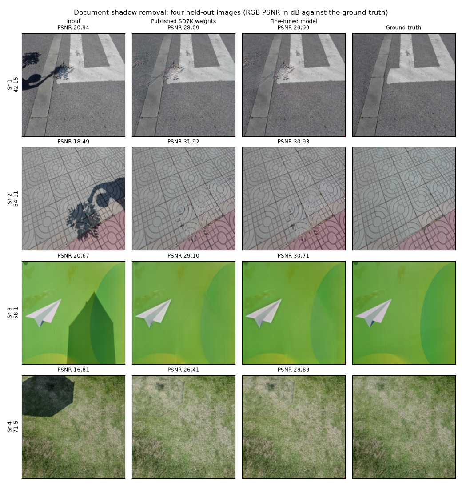
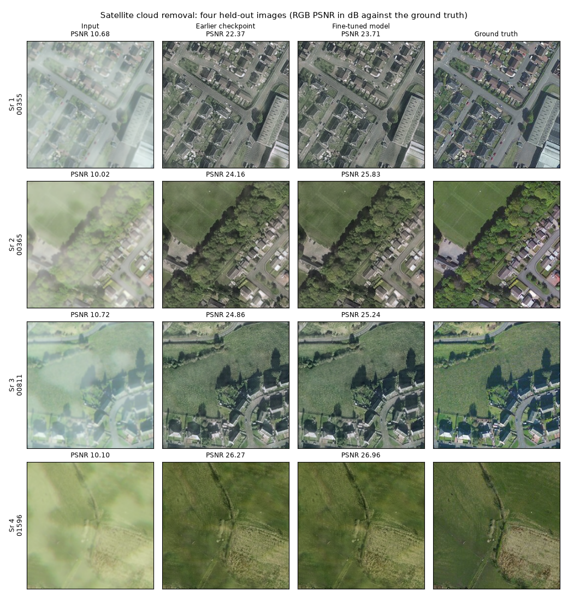

# Generative Vision Lab

We built this lab to train and fine-tune image generation models on a fixed train /
validation / test split and report all three: cloud removal, colourisation, face
restoration, document shadow removal, x6 super-resolution with four architectures,
text-to-image, and six image-to-image translation runs (pix2pix, CycleGAN, CUT). It is
for people choosing or fine-tuning a restoration model who want to see held-out outputs
next to the numbers. A local viewer page shows every saved output side by side.

## Projects

| Project | What | Test result |
|---|---|---|
| [cloud-removal](cloud-removal/) | Satellite cloud removal, SpA-GAN fine-tuned on RICE | PSNR 23.696 dB |
| [colourisation](colourisation/) | Grey to colour (L to ab), ColourNet trained from scratch | PSNR 21.911 dB |
| [face-restoration](face-restoration/) | Degraded face crops, GFPGANv1 generator fine-tuned on FFHQ | PSNR 30.020 dB |
| [document-shadow-removal](document-shadow-removal/) | Shadow removal, DocShadow fine-tuned from SD7K weights | PSNR 30.595 dB |
| [super-resolution](super-resolution/) | x6 super-resolution: ESRGAN, MSRGAN, Real-ESRGAN, Real-ESRNet | PSNR 28.694 dB (ESRGAN) |
| [text-to-image](text-to-image/) | tiny-SD UNet fine-tuned on 833 Pokemon captions | best val loss 0.0513 |
| [gan-translation](gan-translation/) | pix2pix (maps, facades), CycleGAN (apple to orange, summer to winter), CUT (horse to zebra) | see folder |

## What it does

- Trains or fine-tunes each model and reports train, validation and test from its
  `results.json`, with the per-epoch history.
- Saves four held-out samples per project (input, model output, ground truth) and,
  for the GAN translation runs, one output grid per saved epoch.
- `app/` is a local viewer over those saved outputs: pick a task and a sample, see
  every column with its PSNR, zoom into the same region of every column at full
  resolution, and play the translation runs epoch by epoch.

## Screenshots

The viewer (`run.bat`, port 8843). The trained checkpoints are 109-294 MB, over
GitHub's 100 MB limit, so no weights are in the repository and the page shows the
committed outputs; it does not run a model on an uploaded image.


*Document shadow removal, sample 4: the shadowed input (16.81 dB), the published SD7K
weights (26.41 dB), our fine-tuned model (28.63 dB) and the ground truth.*


*x6 ESRGAN, sample 2 with Zoom on: the same 174 px region of a 2040 x 1392 frame in every
column, from the low-res input (27.18 dB) and bicubic (29.65 dB) to the fine-tuned model
(34.00 dB).*


*CUT horse to zebra: the epoch slider at epoch 100 of 100, showing three held-out inputs
and the generator's outputs.*


*The same page at 390 px wide in the dark theme, face restoration selected.*

## Sample input / output

Each figure: four held-out images (Sr 1-4), input on the left, one column per model,
RGB PSNR against the ground truth computed from the saved PNGs. Built by
`python docs/make_figures.py`.

**x6 super-resolution** - a 192 px detail crop of each 2K frame (PSNR over the whole frame):



**Document shadow removal** - the published SD7K weights against our fine-tune:



**Satellite cloud removal:**



More: [face restoration](docs/figures/face_restoration.png),
[colourisation](docs/figures/colourisation.png),
[text to image](docs/figures/text_to_image.png),
[pix2pix maps](gan-translation/pix2pix-maps/samples/e00120.png),
[CUT horse to zebra](gan-translation/cut-h2z/samples/e00100.png).

In the cloud removal, colourisation, face restoration and text-to-image runs the second
column is an **earlier checkpoint** of the same run, not the starting weights: those runs
resumed from a checkpoint, and the training scripts write their "before" images at that
moment.

## Results

From each project's `results.json`:

| Project | Train | Val | Test |
|---|---|---|---|
| Cloud removal (PSNR dB) | 24.126 | 23.967 | 23.696 |
| Colourisation (PSNR dB) | 22.539 | 22.267 | 21.911 |
| Face restoration (PSNR dB) | 30.085 | 29.977 | 30.020 |
| Document shadow removal (PSNR dB) | 30.667 | 30.492 | 30.595 |
| x6 SR, ESRGAN (PSNR dB) | 28.364 | 27.805 | 28.694 |

- Document shadow removal: the published SD7K weights score 27.148 dB on validation;
  fine-tuning lifts that to 30.492.
- x6 super-resolution: all four fine-tuned models beat bicubic on every one of the four
  sample frames, by 0.7 to 4.4 dB.

## Tech stack

- Python, PyTorch
- Models: SpA-GAN, GFPGAN, DocShadow, U-Net (ColourNet), BasicSR / Real-ESRGAN
  (ESRGAN, MSRGAN, Real-ESRGAN, Real-ESRNet), tiny-SD via Hugging Face `diffusers`,
  pix2pix / CycleGAN / CUT
- Viewer: Python standard-library `http.server`, Pillow and NumPy for the per-image
  PSNR, vanilla HTML/CSS/JavaScript with no build step
- Figures: matplotlib; tests: pytest

## Run it

The viewer (Windows, needs [uv](https://docs.astral.sh/uv/)):

```bat
run.bat                      :: opens http://127.0.0.1:8843/
run.bat --port 8850 --no-browser
```

Any platform:

```bash
pip install pillow numpy
python app/server.py --port 8843
```

Tests and figures:

```bash
pip install pillow numpy pytest matplotlib
python -m pytest tests -q
python docs/make_figures.py
```

The training scripts (`*/train_*.py`) need a CUDA GPU, the dataset and the upstream model
code; each project README lists its settings.

## Licence

No licence file is included, so the code is all rights reserved. Datasets (RICE, FFHQ,
ISTD, WIDER FACE, the 2K super-resolution frames, the Pokemon BLIP caption set, CMP Facades, maps,
apple2orange, summer2winter, horse2zebra) and the upstream model weights belong to their
authors.
